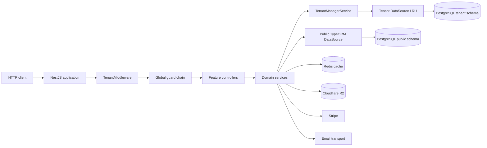
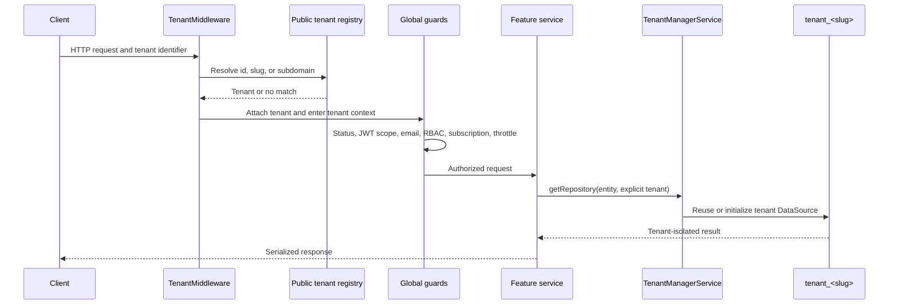

# SaaS Commerce API

NestJS backend for the SaaS Commerce platform. The API owns tenant isolation, authentication,
authorization, commerce data, storage quotas, payments, subscriptions, platform administration,
and operational health checks.

The default REST base path and Swagger UI are both `/api/v1`. The application also serves a
prebuilt platform administration SPA at `/platform`; that static surface is separate from the API.

This document describes only `apps/api`. Source links are relative to this directory.

## API overview

The API is a modular NestJS monolith backed by PostgreSQL. Platform records live in the `public`
schema. Each store has a separate `tenant_<slug>` schema for commerce and tenant identity data.
Tenant resolution happens before authentication so a tenant JWT can be matched to both the public
tenant registry and the selected schema.

Main responsibilities:

- Provision and manage tenant stores.
- Isolate tenant users, RBAC data, catalog, carts, orders, payments, addresses, coupons, and OTPs.
- Authenticate tenant and platform users with separate access and refresh JWTs.
- Enforce roles, permissions, verified email, tenant status, rate limits, and subscription limits.
- Process Stripe Connect order payments and platform-account subscription payments.
- Store product images in Cloudflare R2 and enforce per-tenant storage quotas.
- Cache selected catalog and plan reads in Redis with tenant-aware keys and invalidation.
- Seed platform and tenant reference data through one registry-driven seeding subsystem.

The implementation uses controllers for HTTP concerns, services for domain operations, TypeORM
repositories for persistence, decorators plus global guards for policy enforcement, and explicit
transactions for operations such as checkout, coupon consumption, OTP verification, and storage
accounting.

### High-level architecture



Primary composition files:

- [`src/main.ts`](src/main.ts): HTTP bootstrap, compression, Helmet, CORS, Swagger, validation,
  serialization, response caching, global prefix, and shutdown hooks.
- [`src/app.module.ts`](src/app.module.ts): feature modules, embedded static assets, middleware, and
  global guard order.
- [`src/core.module.ts`](src/core.module.ts): configuration, public TypeORM DataSource, JWT,
  throttling, logging, R2, Redis cache, and health controller.

## Technology stack

| Technology                          | Verified use                                                                                                      |
| ----------------------------------- | ----------------------------------------------------------------------------------------------------------------- |
| Node.js                             | Workspace requires Node.js 20 or newer. [`Dockerfile`](Dockerfile) uses Node.js 22 Alpine.                        |
| NestJS 10                           | HTTP application, modules, dependency injection, guards, interceptors, middleware, and controllers.               |
| TypeScript 5                        | Application source, DTOs, configuration types, tests, and build output.                                           |
| PostgreSQL 16                       | Public platform schema plus one physical schema per tenant.                                                       |
| TypeORM 0.3                         | Public and tenant DataSources, repositories, relationships, transactions, locks, indexes, and synchronization.    |
| JWT and bcrypt                      | Access/refresh tokens through `@nestjs/jwt`; password hashing and verification through `bcrypt`.                  |
| RBAC                                | Roles, role permissions, direct user permissions, rank checks, and permission decorators.                         |
| Redis and ioredis                   | Shared response cache, namespace invalidation, cross-instance invalidation messages, and cache health.            |
| Cloudflare R2                       | S3-compatible product image storage through `@aws-sdk/client-s3`.                                                 |
| Stripe                              | Connect onboarding, destination-charge order payments, webhooks, refunds, and one-off subscription plan payments. |
| Nodemailer                          | SMTP email transport. Log and memory transports support development and tests.                                    |
| class-validator / class-transformer | DTO validation, input transformation, and response serialization.                                                 |
| Joi                                 | Environment validation during application bootstrap.                                                              |
| Helmet / compression / CORS         | Security headers, compressed responses, and browser-origin policy.                                                |
| `@nestjs/throttler`                 | Global request throttling plus stricter route-specific limits.                                                    |
| Pino                                | Structured Nest logging and rotating application log files.                                                       |
| Swagger / OpenAPI                   | Generated API document and Swagger UI at the configured API base path.                                            |
| Jest / ts-jest / Supertest          | Unit, integration, and end-to-end testing.                                                                        |

BullMQ and other job queues are not implemented. Email and Stripe webhook work runs in the API
process.

## Directory structure

```text
apps/api/
|-- src/
|   |-- main.ts                  # HTTP bootstrap
|   |-- app.module.ts            # root feature composition and global guards
|   |-- core.module.ts           # global infrastructure modules
|   |-- common/
|   |   |-- cache/               # Redis store, policies, interceptor, invalidation
|   |   |-- config/              # Joi schema, typed config, CORS, DataSource factory
|   |   |-- constants/           # shared roles, permissions, and currency types
|   |   |-- db/                  # money transformer and unique-conflict retry
|   |   |-- health/              # aggregate health endpoint
|   |   |-- http/                # route-template helpers
|   |   |-- logger/              # Pino and TypeORM file logging
|   |   |-- pagination/          # pagination DTOs and helpers
|   |   |-- storage/             # Cloudflare R2 module, service, and health route
|   |   `-- utils/               # shared money and slug utilities
|   `-- modules/
|       |-- addresses/           # customer delivery addresses
|       |-- auth/                # JWT flows, tenant middleware, guards, decorators
|       |-- cart/                # one cart per customer
|       |-- categories/          # tenant catalog categories
|       |-- coupons/             # coupon management, validation, and redemption
|       |-- currency-requests/   # tenant currency change requests
|       |-- dashboard/           # tenant commerce and storage statistics
|       |-- email/               # SMTP/log/memory delivery abstraction
|       |-- email-otp/           # tenant OTP generation and atomic verification
|       |-- orders/              # checkout and order lifecycle
|       |-- payments/            # Stripe order and subscription payments
|       |-- platform/            # Super Admin tenant, payment, and currency operations
|       |-- products/            # catalog and R2-backed images
|       |-- rbac/                # roles, permissions, and seed mappings
|       |-- seeding/             # registry, bootstrap owner, CLI-facing orchestration
|       |-- storefront/          # narrow public store projections
|       |-- subscriptions/       # plans, entitlements, usage, and guards
|       |-- tenants/             # registry, resolution, provisioning, DataSource manager
|       `-- users/               # tenant and platform user operations
|-- test/                        # E2E config/spec and live-database utility scripts
|-- postman/                     # Postman collection
|-- static/                      # optional embedded platform build, normally generated
|-- .env.example                # documented environment contract
|-- Dockerfile                  # API image build
|-- package.json                # scripts, dependencies, and Jest unit config
|-- eslint.config.mjs           # flat ESLint config
|-- nest-cli.json
|-- tsconfig.json
`-- tsconfig.build.json
```

There is no separate `src/config`, `src/database`, or `src/tenancy` root. Configuration lives in
`src/common/config`; tenant infrastructure lives in `src/modules/tenants` and `src/modules/auth`.
Unit and integration specs live in `specs/` directories that mirror their source areas.

## Modules and business features

All paths below include the default `/api/v1` prefix. Prefix and version are configurable.

| Module            | Responsibility and main data                                                                                                                                                                        | Important endpoints or operations                                                                                                                                                |
| ----------------- | --------------------------------------------------------------------------------------------------------------------------------------------------------------------------------------------------- | -------------------------------------------------------------------------------------------------------------------------------------------------------------------------------- |
| Core and common   | App bootstrap, public DataSource, configuration, validation, logging, throttling, cache, R2, and health.                                                                                            | `GET /health`, `GET /health/storage`, Swagger UI.                                                                                                                                |
| Auth              | Tenant customer registration, store registration, tenant/platform login, refresh rotation, logout, password reset, and credential issuance. Depends on users, tenants, subscriptions, OTP, and JWT. | `POST /auth/register`, `/auth/register-store`, `/auth/login`, `/auth/login/platform`, `/auth/refresh`, `/auth/logout`, `/auth/logout/platform`, `/auth/password-reset/confirm`.  |
| Email OTP         | Tenant-schema `OtpChallenge` generation, anti-enumeration responses, resend limits, attempt limits, HMAC hashing, and atomic consumption.                                                           | `POST /auth/email-otp/request`, `POST /auth/email-otp/verify`.                                                                                                                   |
| Email             | `EmailService` over SMTP, log, or in-memory transports. No HTTP controller.                                                                                                                         | Sends verification and recovery OTP messages.                                                                                                                                    |
| Users             | Tenant user profiles and management, role assignment, direct permission grants, password/session updates, and platform-user lookup for auth. Main entity: `User`.                                   | Profile, list, create, update, delete, role assignment/removal, and permission grant/revoke operations under `/users`.                                                           |
| RBAC              | Tenant and platform `Role` and `Permission` management. Protects system roles and reserved keys.                                                                                                    | CRUD under `/roles` and `/permissions`; seeding of platform and tenant role maps.                                                                                                |
| Tenants           | Public `Tenant` registry, resolution, status policy, schema provisioning, storage accounting, and per-schema DataSource lifecycle.                                                                  | Internal services used by registration, platform operations, auth, storage, and subscriptions.                                                                                   |
| Platform          | Super Admin tenant inspection/lifecycle, payment controls, Stripe payout settings, and currency request review.                                                                                     | `/platform/tenants`, `/platform/payments`, and `/platform/currency-requests` operations.                                                                                         |
| Products          | Tenant `Product` and `ProductImage` catalog, filters, sort, pagination, stock, category relation, subscription product limit, and R2 image lifecycle.                                               | Public `GET /products` and `GET /products/:id`; protected CRUD and image upload/delete/reorder.                                                                                  |
| Categories        | Tenant `Category` management and active storefront projection. Product deletion behavior uses nullable category relations.                                                                          | Protected CRUD under `/categories`; public category options at `GET /store/categories`.                                                                                          |
| Cart              | One tenant `Cart` per user and unique `CartItem` per product. Enforces active products, stock, 100-item cart cap, and quantity cap of 99.                                                           | `GET /cart`, add/update/remove items, and clear cart.                                                                                                                            |
| Orders            | Transactional checkout, immutable item/address/coupon snapshots, stock changes, customer order access, cancellation, returns, and staff status updates.                                             | `POST /orders`, `GET /orders`, `GET /orders/:id`, cancel, return, and status routes.                                                                                             |
| Coupons           | Tenant `Coupon` and `CouponRedemption` data, preview validation, locked checkout consumption, usage restoration, feature checks, and monthly plan quota.                                            | `POST /coupons/validate`; CRUD and status operations under `/coupons`.                                                                                                           |
| Payments          | Tenant `Payment`, public `SubscriptionPayment`, Stripe Connect onboarding, order intents, subscription intents, signed webhook handling, refunds, and free-plan fallback.                           | `/payments/stripe`, `/payments/stripe/subscription`, `/payments/stripe/subscription/cancel`, `/payments/stripe/webhook`, `/payments/stripe/account`, `/payments/stripe/connect`. |
| Addresses         | Tenant `Address` CRUD, ownership enforcement, and one-default-address constraint. Orders copy address fields into an immutable delivery snapshot.                                                   | CRUD and default-address operations under `/addresses`.                                                                                                                          |
| Dashboard         | Tenant order, revenue, product, customer, schema-size, and storage statistics.                                                                                                                      | `GET /dashboard/stats`.                                                                                                                                                          |
| Currency requests | Public `CurrencyChangeRequest` workflow with one pending request per tenant. Tenant creates requests; Super Admin approves or rejects them.                                                         | Tenant store-currency operations and `/platform/currency-requests` review routes.                                                                                                |
| Storefront        | Minimal public tenant projections that avoid exposing management models.                                                                                                                            | `GET /store/info`, `GET /store/categories`.                                                                                                                                      |
| Subscriptions     | Public plans, limits, features, tenant subscription state, usage counters, entitlement checks, plan assignment, and read-time refund eligibility.                                                   | Tenant reads at `/subscription`; platform plan CRUD and tenant assignment/usage under `/platform`.                                                                               |
| Seeding           | Ordered, idempotent platform and tenant seeders plus boot orchestration and CLI safety. No HTTP controller.                                                                                         | Boot seed and `seed`, `seed:platform`, `seed:tenants`, `seed:all` scripts.                                                                                                       |

Most feature directories include a `workflow.md` Mermaid flow. Start with
[`workflow.md`](workflow.md), then use module-specific files such as
[`src/modules/auth/workflow.md`](src/modules/auth/workflow.md),
[`src/modules/tenants/workflow.md`](src/modules/tenants/workflow.md), and
[`src/modules/orders/workflow.md`](src/modules/orders/workflow.md).

## REST API conventions

### Prefix and route organization

- `API_PREFIX` and `API_VERSION` form the global prefix. Defaults in `.env.example` produce
  `/api/v1`.
- Swagger UI and its generated document are mounted at the same base path.
- Tenant routes require tenant resolution even when marked `@Public()`.
- Platform routes use `@Platform()` and do not require tenant headers.
- Controllers return their service result directly. There is no global response-envelope
  interceptor.

### Validation and serialization

[`src/main.ts`](src/main.ts) installs one global `ValidationPipe` with:

```ts
{
  whitelist: true,
  forbidNonWhitelisted: true,
  transform: true,
}
```

Unknown DTO properties therefore fail with HTTP 400. Route parameters commonly use
`ParseIntPipe`. `ClassSerializerInterceptor` runs inside the response-cache interceptor so fields
marked with `@Exclude`, including password and refresh-session identifiers, are removed before a
response can be cached.

### Pagination, filtering, sorting, and search

Pagination is opt-in per endpoint rather than globally imposed. Shared helpers live in
[`src/common/pagination`](src/common/pagination). User, order, coupon, plan, and product list DTOs
define their own allowed filters.

`GET /products` supports these verified query parameters:

- `search`: trimmed, case-insensitive search across product text fields.
- `categoryId`, `minPrice`, `maxPrice`, and `inStock`.
- `sortBy` and `sortOrder` from allowlisted values.
- `page` and `limit`; the limit is capped at 50.

When neither `page` nor `limit` is supplied, the product endpoint preserves its array response.
When pagination is requested, it returns `{ data, total, page, limit }`.

### Errors

Nest exceptions provide standard HTTP status handling. Subscription and OTP flows also return
domain bodies such as `{ code, message }`. There is no global exception filter, so error bodies are
not normalized across every module.

### Health

`GET /api/v1/health` is public, platform-scoped, and exempt from throttling. Its shape is:

```json
{
  "status": "ok",
  "db": true,
  "r2": true,
  "cache": {
    "enabled": true,
    "driver": "redis",
    "connected": true
  }
}
```

Top-level status is `ok` only when PostgreSQL and R2 checks succeed; Redis connectivity is reported
but does not change that status. `GET /api/v1/health/storage` exposes the focused R2 check.

### Verified request examples

Check health:

```bash
curl http://localhost:4000/api/v1/health
```

Read tenant store metadata without authentication:

```bash
curl -H "x-tenant-slug: demo" \
  http://localhost:4000/api/v1/store/info
```

Request a filtered public product page:

```bash
curl -H "x-tenant-slug: demo" \
  "http://localhost:4000/api/v1/products?page=1&limit=20&sortBy=price&sortOrder=asc&inStock=true"
```

Authenticate to a tenant:

```bash
curl -X POST http://localhost:4000/api/v1/auth/login \
  -H "Content-Type: application/json" \
  -H "x-tenant-slug: demo" \
  -d '{"email":"owner@example.com","password":"replace-with-a-real-password"}'
```

See [`postman/saas_store.postman_collection.json`](postman/saas_store.postman_collection.json) for
the repository request collection. Generated Swagger output remains the most complete live route
reference.

## Authentication and authorization

### Registration and login

- `POST /auth/register` is public but tenant-scoped. It creates a `CUSTOMER` and dispatches an
  email-verification OTP.
- `POST /auth/register-store` is public and platform-scoped. It creates the public tenant record,
  creates the tenant schema, seeds tenant RBAC, assigns the free plan, creates the `STORE_OWNER`,
  records the owner id, and returns credentials.
- `POST /auth/login` resolves a tenant and verifies the tenant-schema user password.
- `POST /auth/login/platform` reads the public user table and accepts only `SUPER_ADMIN`.
- `POST /auth/refresh` verifies the refresh secret, token type, issuer, audience, tenant registry,
  tenant status, user, and current stored `jti` before rotating credentials.
- Tenant and platform logout routes clear the stored `jti`, revoking the active refresh session.

Access and refresh tokens use separate secrets and expirations. Both carry `type`, user `id`, role,
`tenantId`, and `tenantSchema`. Refresh tokens also carry a random `jti`; access tokens do not.
Platform tokens carry null tenant claims.

### Global guard order

[`src/app.module.ts`](src/app.module.ts) registers guards in this exact order:

1. `TenantGuard`
2. `JwtGuard`
3. `EmailVerifiedGuard`
4. `PermissionGuard`
5. `SubscriptionGuard`
6. `ThrottlerGuard`

Order is security-sensitive:

- `TenantGuard` requires an active resolved tenant on non-platform API routes. No identifier gives
  HTTP 400; an identifier that does not resolve gives HTTP 404; an inactive tenant gives HTTP 403.
- `JwtGuard` skips `@Public()` routes. It verifies access-token type, signature, issuer, audience,
  route scope, tenant id, tenant schema, and current user. A tenant token cannot access a platform
  route, and a platform token cannot access a tenant route.
- `EmailVerifiedGuard` applies to authenticated tenant routes. `@AllowUnverifiedEmail()` is used
  only for tenant logout so an unverified user can clear the session.
- `PermissionGuard` checks `@Roles()` first and then requires every `@Permissions()` value.
  `SUPER_ADMIN` bypasses tenant-style role and permission checks.
- `SubscriptionGuard` skips public, platform, and unannotated routes. Its decorators enforce active
  subscription, feature, or limit metadata while service-level checks remain authoritative.
- `ThrottlerGuard` applies last, including on cache hits, unless a route explicitly skips it.

`@Public()` skips authentication and permission checks, not tenant resolution. `@Platform()` skips
tenant resolution and identifies routes that require platform-scoped credentials when protected.

### RBAC model

System roles are `SUPER_ADMIN`, `STORE_OWNER`, `ADMIN`, and `CUSTOMER`. Authorization combines a
user's direct grants with permissions attached to the user's role. `JwtGuard` deduplicates that
union before `PermissionGuard` evaluates it.

Role rank prevents lower-privileged actors from modifying peers or higher-ranked users. User
creation enforces the store-admin subscription limit. Role-assignment routes declare the same
HTTP-layer limit, but the current `assignRole` service does not recheck or lock that limit. Seed data
and the shared permission-key union live in [`src/modules/rbac`](src/modules/rbac) and
[`src/common/constants`](src/common/constants).

### Email OTP

OTP challenges are tenant data. A request for an unknown email returns the same success body as a
known email and sends nothing. Codes are stored only as an HMAC-SHA256 hash that includes the
challenge id. Verification locks the newest challenge, checks expiry and attempt limits, and marks
the challenge consumed exactly once.

Implemented purposes cover email verification and password reset.
Platform-admin OTP is not implemented. Set `OTP_REQUIRE_EMAIL_VERIFIED=true` to block password login
before verification; authenticated tenant routes are independently protected by
`EmailVerifiedGuard`.

## Multi-tenant architecture

### Tenant resolution

[`TenantResolutionService`](src/modules/tenants/services/tenant-resolution.service.ts) resolves in
this order:

1. `x-tenant-id`
2. `x-tenant-slug`
3. Subdomain from `Host`, relative to `APP_ROOT_DOMAIN`

`TenantMiddleware` acts only on configured API paths and Swagger JSON paths. On success it attaches
the public `Tenant` entity to the request and enters an `AsyncLocalStorage` context containing the
tenant and schema name. A miss continues to the guard so the guard can distinguish a missing
identifier from an unknown tenant.

### Request lifecycle



### Schema and connection management

`TenantManagerService` owns one TypeORM DataSource per schema:

- LRU cache cap of 100 initialized DataSources.
- In-flight initialization deduplication per schema.
- Move-to-front behavior on a cache hit.
- Pool size from `TENANT_POOL_SIZE`.
- Destruction on eviction, tenant deactivation, explicit release, and module shutdown.
- Tenant synchronization only when `DB_SYNCHRONIZE` is true and production policy allows it.

Tenant services request repositories with an explicit `TenantRef`; the manager does not infer a
tenant from `AsyncLocalStorage`. Helpers in
[`src/modules/tenants/utils/tenant-scope.ts`](src/modules/tenants/utils/tenant-scope.ts) enforce
context when a service starts from the current request.

### Provisioning and isolation controls

Store registration creates a sanitized `tenant_<slug>` schema, initializes its DataSource, seeds
tenant roles and permissions, assigns the free subscription, and creates the owner inside that
schema. Public tenant identifiers and schema names are unique.

Cross-tenant access is constrained by:

- Separate PostgreSQL schemas and entity registration lists.
- Matching both JWT `tenantId` and `tenantSchema` against the resolved registry record.
- Explicit tenant repository selection.
- Tenant-aware Redis namespaces.
- R2 object keys prefixed with the tenant schema.
- Active-tenant checks during requests and refresh-token rotation.

## Database design

### Public schema

[`PUBLIC_ENTITIES`](src/core.module.ts) contains only platform data:

- `Tenant`: registry, status, owner id, currency, R2 usage/capacity, Stripe account, and payment
  controls.
- `User`, `Role`, and `Permission`: platform identity and `SUPER_ADMIN` RBAC.
- `CurrencyChangeRequest`: tenant currency workflow with a partial unique index for one pending
  request per tenant.
- `SubscriptionPlan`, `SubscriptionPlanLimit`, and `SubscriptionPlanFeature`: public plan catalog.
- `Subscription`: one public subscription per tenant.
- `SubscriptionPayment`: public ledger for one-off plan payments and refunds.
- `TenantUsageCounter`: unique tenant/metric/period counters for atomic quota use.

The platform user table is `user` (singular).

### Tenant schemas

[`TENANT_ENTITIES`](src/modules/tenants/utils/tenant-entities.ts) contains:

- `User`, `Role`, and `Permission`, including role and direct-permission join tables.
- `Product`, `ProductImage`, and `Category`.
- `Cart` and `CartItem`.
- `Order` and `OrderItem`.
- `Payment`.
- `Address`.
- `Coupon` and `CouponRedemption`.
- `OtpChallenge`.

Important relationships and constraints include:

- Unique tenant user email; the same email can exist in different tenants.
- Nullable user role with `ON DELETE SET NULL`; role and direct-permission many-to-many joins.
- Unique product SKU, unique nullable product slug, nullable category relation, and cascading image
  ownership.
- One cart per user and one cart item per cart/product pair.
- Order-item, address, coupon, and price snapshots preserve checkout history.
- One default address per user through a partial unique index.
- Unique coupon code per tenant and unique coupon/order redemption pair.
- One active OTP challenge per user/purpose through a partial unique index.

Money fields use PostgreSQL numeric columns with shared conversion helpers. Foreign-key delete
behavior is chosen per history requirement: order snapshots preserve deleted product/user data,
while dependent cart and image rows cascade.

### Transactions and consistency

- Checkout creates the order and items, locks and consumes a coupon, updates stock, records a
  redemption, and clears the cart inside a tenant transaction.
- Coupon rows use pessimistic locks before limit checks and consumption.
- Storage usage updates lock the public tenant row and reject capacity overflow.
- OTP verification pessimistically locks the latest challenge before increment or consumption.
- Store-admin limit checks serialize on the public subscription row.
- Monthly coupon usage uses an atomic PostgreSQL upsert with a limit condition.

### Synchronization and migrations

No TypeORM migration files or migration scripts exist. Public schema creation depends on
`DB_SYNCHRONIZE`. Tenant DataSources synchronize from entity metadata in non-production when
`DB_SYNCHRONIZE` is enabled; production additionally requires `DB_SYNCHRONIZE_TENANTS=true`.

Treat synchronization as bootstrap support, not a safe production migration strategy. Existing
production schemas need an explicit migration process before routine synchronization can be
disabled permanently. The OTP schema utility in `test/migrate-otp-challenges.ts` is an idempotent
one-off script, not a general migration framework.

## Caching and performance

### Redis response cache

[`src/common/cache`](src/common/cache) implements an opt-in, shared Redis cache. Redis is the only
cache driver; it is not used as a queue.

Verified behavior:

- Tenant keys include API version, tenant schema, policy namespace, and a SHA-256 request
  fingerprint.
- Platform subscription-plan reads use one shared platform namespace.
- Fingerprints use stable, versioned canonical input for method, route, params, and query.
- Concurrent misses use a bounded single-flight map.
- Namespace versions and Lua scripts reject writes that raced with invalidation.
- Redis pub/sub marks matching in-flight loads stale on every API replica.
- Invalidation indexes use Redis sets; the implementation does not use `KEYS` or `SCAN`.
- Store errors and command timeouts fail open: the request loads from PostgreSQL and logs a warning.
- Entries larger than `CACHE_MAX_ENTRY_BYTES` are not cached.

Only these routes can cache responses:

- `GET /products`
- `GET /products/:id`
- `GET /categories`
- `GET /categories/:id`
- `GET /subscription/plans`
- `GET /platform/subscription-plans`

Product, category, checkout/order, image, and plan mutations invalidate affected namespaces after
their writes complete. Cache metadata on any route outside the allowlist is ignored with a warning.

All responses still send `Cache-Control: no-store`. Cacheable responses add `X-Cache` with
`HIT`, `MISS`, or `BYPASS`; tenant responses also vary on host and tenant headers. Default TTLs in
`.env.example` are 30 seconds for products and 300 seconds for categories and plans.

### Other performance controls

- PostgreSQL pools are separate for public and tenant DataSources.
- `DB_STATEMENT_TIMEOUT_MS` applies PostgreSQL `statement_timeout` to every DataSource.
- Product and management list routes support bounded pagination.
- Database indexes cover unique identifiers and common ownership/status lookups.
- HTTP responses use compression above 512 bytes.
- Tenant DataSources and cache loads both use bounded in-memory maps.

Configure Redis `maxmemory` above the working set and use `allkeys-lru`. Evicting a namespace index
or version key weakens invalidation to the entry TTL.

## External integrations

| Integration                   | Purpose                                                                                  | Main implementation                                                | Required configuration                                                                      |
| ----------------------------- | ---------------------------------------------------------------------------------------- | ------------------------------------------------------------------ | ------------------------------------------------------------------------------------------- |
| PostgreSQL                    | Public registry/platform data and isolated tenant schemas.                               | `src/common/config/data-source.factory.ts`, `TenantManagerService` | `DB_*`, tenant pool and synchronization settings.                                           |
| Redis                         | Shared response cache, invalidation, and connectivity reporting.                         | `src/common/cache`                                                 | `REDIS_URL`, cache limits, TTLs, and Redis timeouts.                                        |
| Cloudflare R2                 | Product image upload, delete, public URL generation, quota accounting, and health.       | `src/common/storage`, `ProductsService`                            | `R2_*`, `MAX_FILE_SIZE`, `MAX_PRODUCT_IMAGES`.                                              |
| Stripe Connect                | Tenant account onboarding and destination-charge order payments.                         | `StripePaymentService`                                             | Stripe secret, publishable key, webhook secret, fee basis points, optional onboarding URLs. |
| Stripe platform payments      | One-off SaaS plan PaymentIntents, public ledger, refund window, and free-plan downgrade. | payments and subscriptions modules                                 | Same Stripe keys; no Stripe Billing price ids are stored.                                   |
| SMTP / Nodemailer             | OTP email delivery in production.                                                        | `src/modules/email`                                                | Email sender values and conditional SMTP settings.                                          |
| Log or memory email transport | Development delivery seam and deterministic tests.                                       | `src/modules/email/transports`                                     | `EMAIL_PROVIDER=log` or `memory`.                                                           |
| Pino and rotating files       | Structured application logs and TypeORM query/error logs.                                | `src/common/logger`                                                | `LOG_LEVEL` and filesystem permissions.                                                     |

There is no BullMQ, message broker, SMS provider, or recurring Stripe Billing integration. The
in-process subscription lifecycle worker only reconciles local subscription timestamps.

## Configuration and environment variables

Copy [`apps/api/.env.example`](.env.example) to `apps/api/.env` and replace placeholders. Joi
validation in [`src/common/config/env.schema.ts`](src/common/config/env.schema.ts) runs before the
application starts. Production validation rejects placeholder secrets, requires strong secret
lengths, and requires JWT issuer/audience values.

Never commit `.env` or log secret values.

### Application and server

| Variable                         | Purpose and requirement                                                                                           |
| -------------------------------- | ----------------------------------------------------------------------------------------------------------------- |
| `NODE_ENV`                       | Runtime mode. Controls production secret rules and tenant synchronization policy. Example default: `development`. |
| `APP_NAME`                       | Application and Swagger title. Required project identity.                                                         |
| `APP_PORT`                       | HTTP listen port. Example default: `4000`.                                                                        |
| `API_PREFIX`                     | Global route prefix segment. Example default: `api`.                                                              |
| `API_VERSION`                    | Global route version segment. Example default: `v1`.                                                              |
| `APP_ROOT_DOMAIN`                | Required root domain used to resolve tenant subdomains and permit root-domain CORS origins.                       |
| `BOOTSTRAP_SUPER_ADMIN_EMAIL`    | Bootstrap platform account email. Required when no Super Admin exists.                                            |
| `BOOTSTRAP_SUPER_ADMIN_PASSWORD` | Bootstrap platform password. Required with the bootstrap email; use a real secret.                                |
| `BOOTSTRAP_SUPER_ADMIN_NAME`     | Bootstrap display name. Optional when an account already exists.                                                  |

### PostgreSQL and tenant storage

| Variable                        | Purpose and requirement                                                                                  |
| ------------------------------- | -------------------------------------------------------------------------------------------------------- |
| `DB_NAME`                       | PostgreSQL database name. Required.                                                                      |
| `DB_HOST`                       | Database host. Required; use `127.0.0.1` from the host or `host.docker.internal` from the API container. |
| `DB_PORT`                       | PostgreSQL port. Example default: `5432`.                                                                |
| `DB_USERNAME`                   | Database user. Required.                                                                                 |
| `DB_PASSWORD`                   | Database password. Required and secret.                                                                  |
| `DB_SYNCHRONIZE`                | Enables TypeORM schema synchronization. Use only with an understood rollout policy.                      |
| `DB_SYNCHRONIZE_TENANTS`        | Additional production opt-in for tenant-schema synchronization. Default: `false`.                        |
| `DB_LOGGING`                    | Enables TypeORM logging.                                                                                 |
| `DB_SSL`                        | Enables PostgreSQL TLS options.                                                                          |
| `DB_STATEMENT_TIMEOUT_MS`       | Per-statement PostgreSQL timeout. `0` disables it; example default: `30000`.                             |
| `TENANT_POOL_SIZE`              | Maximum pool size for each tenant DataSource. Example default: `5`.                                      |
| `TENANT_STORAGE_CAPACITY_BYTES` | Initial R2 byte capacity before a subscription plan synchronizes the value.                              |
| `TENANT_DB_CAPACITY_BYTES`      | Display-only tenant schema capacity used in statistics. It does not enforce DB usage.                    |

### JWT and password hashing

| Variable                 | Purpose and requirement                                                                                       |
| ------------------------ | ------------------------------------------------------------------------------------------------------------- |
| `JWT_ACCESS_SECRET`      | Access-token signing secret. Required; production requires a non-placeholder value of at least 32 characters. |
| `JWT_REFRESH_SECRET`     | Refresh-token signing secret. Same production rules as access secret.                                         |
| `JWT_ACCESS_EXPIRES_IN`  | Short access-token lifetime accepted by the JWT library; recommended example: `15m`.                          |
| `JWT_REFRESH_EXPIRES_IN` | Refresh-token lifetime, for example `7d`.                                                                     |
| `JWT_ISSUER`             | Verified on access and refresh tokens; required in production.                                                |
| `JWT_AUDIENCE`           | Verified on access and refresh tokens; required in production.                                                |
| `BCRYPT_ROUNDS`          | Password-hash work factor. Example default: `12`.                                                             |

Run the user-token-version migrations before deploying this auth code. Replicas running the old
guard do not enforce immediate revocation, so use a non-overlapping cutover or drain every old
replica before relying on the guarantee. Rotate the access-token secret during a compromise
cutover when old replicas cannot be drained atomically.

### Redis cache

| Variable                         | Purpose and requirement                                                                                  |
| -------------------------------- | -------------------------------------------------------------------------------------------------------- |
| `REDIS_URL`                      | Redis connection URL. Required by configuration; use `rediss://` for native TLS.                         |
| `CACHE_ENABLED`                  | Enables cache reads and writes. The Redis store still supplies health and invalidation infrastructure.   |
| `CACHE_MAX_ENTRY_BYTES`          | Maximum serialized value size. Example default: 256 KiB.                                                 |
| `CACHE_MAX_INFLIGHT`             | Maximum tracked single-flight loads.                                                                     |
| `CACHE_OPERATION_TIMEOUT_MS`     | Timeout for normal cache commands; failures fall open.                                                   |
| `CACHE_PRODUCTS_TTL_SECONDS`     | Product response TTL.                                                                                    |
| `CACHE_CATEGORIES_TTL_SECONDS`   | Category response TTL.                                                                                   |
| `CACHE_PLANS_TTL_SECONDS`        | Subscription-plan response TTL.                                                                          |
| `CACHE_REDIS_TLS`                | Forces TLS options for a plain Redis URL behind a TLS proxy.                                             |
| `CACHE_REDIS_CONNECT_TIMEOUT_MS` | Connection and health-readiness timeout.                                                                 |
| `CACHE_REDIS_COMMAND_TIMEOUT_MS` | ioredis command timeout.                                                                                 |
| `CACHE_REDIS_SAFETY_TTL_SECONDS` | Lifetime for namespace indexes and versions; raised internally when shorter than entry TTL safety needs. |

### Cloudflare R2 and uploads

| Variable               | Purpose and requirement                                                          |
| ---------------------- | -------------------------------------------------------------------------------- |
| `R2_ACCOUNT_ID`        | Cloudflare account id. Required.                                                 |
| `R2_ACCESS_KEY_ID`     | R2 S3 access key id. Required and secret.                                        |
| `R2_SECRET_ACCESS_KEY` | R2 S3 secret key. Required; production placeholder checks apply.                 |
| `R2_BUCKET`            | Upload bucket name. Required.                                                    |
| `R2_PUBLIC_URL`        | Public bucket or CDN base URL without a trailing slash. Required for image URLs. |
| `MAX_FILE_SIZE`        | Per-image upload byte limit. Example default: 5 MiB.                             |
| `MAX_PRODUCT_IMAGES`   | Maximum images attached to one product. Example default: `5`.                    |

### Stripe

| Variable                        | Purpose and requirement                                               |
| ------------------------------- | --------------------------------------------------------------------- |
| `STRIPE_SECRET_KEY`             | Server-side Stripe API key. Required and secret.                      |
| `STRIPE_PUBLISHABLE_KEY`        | Safe publishable key returned where clients need Stripe.js. Required. |
| `STRIPE_WEBHOOK_SECRET`         | Signature secret for `/payments/stripe/webhook`. Required and secret. |
| `STRIPE_APPLICATION_FEE_BPS`    | Platform fee for destination charges in basis points. Default: `0`.   |
| `STRIPE_ONBOARDING_RETURN_URL`  | Optional fallback return URL for Stripe Connect onboarding.           |
| `STRIPE_ONBOARDING_REFRESH_URL` | Optional fallback refresh URL for expired onboarding links.           |

Trusted request origins can supply tenant-specific onboarding return URLs. Secrets are never
returned or logged.

### Email and OTP

| Variable                      | Purpose and requirement                                                           |
| ----------------------------- | --------------------------------------------------------------------------------- |
| `OTP_LENGTH`                  | Numeric OTP length. Example default: `6`.                                         |
| `OTP_EXPIRATION_SECONDS`      | Challenge lifetime. Example default: `600`.                                       |
| `OTP_MAX_ATTEMPTS`            | Failed verification limit per challenge.                                          |
| `OTP_RESEND_COOLDOWN_SECONDS` | Minimum resend interval.                                                          |
| `OTP_MAX_REQUESTS`            | Maximum requests in the configured request window.                                |
| `OTP_REQUEST_WINDOW_SECONDS`  | Request-rate accounting window.                                                   |
| `OTP_HASH_SECRET`             | HMAC secret for OTP hashes. Required and secret; production strength rules apply. |
| `OTP_REQUIRE_EMAIL_VERIFIED`  | When true, password login rejects unverified tenant users.                        |
| `EMAIL_PROVIDER`              | `smtp`, `log`, or `memory`. Example local value: `log`.                           |
| `EMAIL_FROM_ADDRESS`          | Sender address. Required.                                                         |
| `EMAIL_FROM_NAME`             | Sender display name.                                                              |
| `SMTP_HOST`                   | Required when `EMAIL_PROVIDER=smtp`.                                              |
| `SMTP_PORT`                   | Required when `EMAIL_PROVIDER=smtp`; example default: `587`.                      |
| `SMTP_USER`                   | Optional or provider-specific SMTP username.                                      |
| `SMTP_PASSWORD`               | Optional or provider-specific secret; production validation applies when set.     |
| `SMTP_SECURE`                 | Enables the configured secure SMTP connection behavior.                           |

The log transport does not print OTP codes.

### CORS, throttling, logging, and seeding

| Variable                | Purpose and requirement                                                                                 |
| ----------------------- | ------------------------------------------------------------------------------------------------------- |
| `CORS_ORIGIN`           | Comma-separated exact browser origins. Hosts on `APP_ROOT_DOMAIN` and its subdomains are also accepted. |
| `CORS_CREDENTIALS`      | Sets the CORS credentials option.                                                                       |
| `THROTTLE_TTL`          | Global throttling window in seconds. Example default: `60`.                                             |
| `THROTTLE_LIMIT`        | Global request limit per window. Example default: `100`.                                                |
| `LOG_LEVEL`             | Pino application log level. Example default: `debug`.                                                   |
| `SEED_ALLOW_PRODUCTION` | First production seeding gate. CLI use also requires `--force`. Default: `false`.                       |

## Local development

Run workspace commands from the repository root.

### Prerequisites

- Node.js 20 or newer and pnpm through Corepack.
- Reachable PostgreSQL 16 database. Compose does not create PostgreSQL.
- Reachable Redis. The repository Compose file can start it.
- Valid `apps/api/.env` values for PostgreSQL, JWT, R2, Redis, Stripe, OTP, and email.

### Install and start

PowerShell:

```powershell
pnpm install
Copy-Item apps/api/.env.example apps/api/.env
docker compose up -d redis
pnpm --filter saas_store_api dev
```

When the API runs on the host, set `DB_HOST=127.0.0.1` for a local PostgreSQL server. When the API
runs in Docker, `host.docker.internal` reaches PostgreSQL on the Docker host.

### Build and production start

```powershell
pnpm --filter saas_store_api build
pnpm --filter saas_store_api start:prod
```

`start:prod` runs `node dist/main`, so build first.

### Quality and test commands

```powershell
pnpm --filter saas_store_api typecheck
pnpm --filter saas_store_api lint
pnpm --filter saas_store_api format
pnpm --filter saas_store_api test
pnpm --filter saas_store_api test:watch
pnpm --filter saas_store_api test:cov
pnpm --filter saas_store_api test:integration
pnpm --filter saas_store_api test:e2e
```

`lint` and `format` write changes. Review their diffs before committing.

### Seeding

```powershell
pnpm --filter saas_store_api seed
pnpm --filter saas_store_api seed:platform
pnpm --filter saas_store_api seed:tenants
pnpm --filter saas_store_api seed -- --tenants --name categories
pnpm --filter saas_store_api seed -- --tenant demo
```

The default command seeds platform data and all active tenants. Flags include `--platform`,
`--tenants`, `--all`, repeated or comma-separated `--name`, `--tenant <id|slug>`, and `--force`.
Production requires both `SEED_ALLOW_PRODUCTION=true` and `--force`. Base categories are opt-in and
do not run during normal bootstrap or provisioning.

### Docker

From the repository root:

```powershell
docker compose -f apps/docker-compose.yml up -d --build
```

Repository Compose runs the API and Redis. PostgreSQL remains external. The API image uses
[`Dockerfile`](Dockerfile), copies the generated `static/` directory, builds Nest output, and starts
`node dist/main`. Ensure required environment files and embedded static assets exist before a
deployment build.

## Testing strategy

### Unit tests

Jest configuration is inline in [`package.json`](package.json):

- `rootDir: src`
- `testRegex: .*\.spec\.ts$`
- TypeScript transform through `ts-jest`
- `src/*` module-name mapping
- Node test environment
- Coverage output in `apps/api/coverage`
- DTOs, modules, enums, entities, interfaces, helpers, and `main.ts` excluded from collection where
  configured

Specs live under mirrored `specs/` directories. Current source includes tests for common cache,
configuration, DB helpers, health, pagination, storage, and utilities, plus addresses, auth, cart,
categories, coupons, currency requests, dashboard, email, email OTP, orders, payments, platform,
products, RBAC, seeding, storefront, subscriptions, tenants, and users.

`pnpm --filter saas_store_api test` excludes paths containing `integration`.
`pnpm --filter saas_store_api test:integration` selects those integration specs explicitly.

### End-to-end tests

[`test/jest-e2e.json`](test/jest-e2e.json) configures Supertest-based E2E execution.
[`test/app.e2e-spec.ts`](test/app.e2e-spec.ts) covers basic validation and tenant-guard behavior.
The E2E suite is small and does not replace live multi-tenant verification.

### Manual live-database scripts

These scripts boot the application and require a valid `.env`, PostgreSQL, Redis, R2/Stripe-safe
test configuration, and care around destructive operations:

```powershell
pnpm --dir apps/api exec ts-node -r tsconfig-paths/register test/verify-tenant-provision.ts
pnpm --dir apps/api exec ts-node -r tsconfig-paths/register test/verify-tenant-guard.ts
pnpm --dir apps/api exec ts-node -r tsconfig-paths/register test/verify-tenant-lifecycle.ts
pnpm --dir apps/api exec ts-node -r tsconfig-paths/register test/verify-register-store-guard.ts
pnpm --dir apps/api exec ts-node -r tsconfig-paths/register test/verify-email-otp.ts
```

Run scripts from the repository root as shown. `reset-dev-db.ts` drops tenant schemas and truncates
public authentication data; do not run it against shared or production databases. `seed-load-test.ts`
creates the dataset used by repository k6 tests.

This README update does not claim test success unless the command is listed in the completion
report as executed during the documentation task.

## Security and operations

### Implemented controls

- Joi validates configuration before bootstrap and applies stronger production secret rules.
- Helmet sets security headers. Content Security Policy is disabled so Swagger UI can run.
- CORS uses an exact allowlist plus `APP_ROOT_DOMAIN` and its subdomains.
- Global DTO validation strips allowed input and rejects unknown fields.
- Access-token verification includes signature, type, issuer, audience, route scope, and tenant
  claims.
- Refresh-token rotation uses a stored `jti` and tenant status revalidation.
- Tenant isolation combines physical schemas, explicit repository scope, JWT matching, cache
  namespaces, and storage prefixes.
- Email OTP uses HMAC hashing, timing-safe comparison, expiry, attempt limits, resend limits, and
  locked single consumption.
- Global and route-specific rate limits protect health-independent HTTP work; health explicitly
  skips throttling.
- Stripe webhook signatures use Nest raw-body support.
- Password and session fields use serialization exclusion.
- Pino supplies structured logs; TypeORM has a daily rotating logger.
- `enableShutdownHooks()` closes managed resources during normal Nest shutdown.

### Operational behavior

- Health reports PostgreSQL, R2, and Redis cache connectivity.
- Redis request-path failures are timeout-bounded and fail open.
- Tenant DataSources close on eviction and application shutdown.
- Database statement timeout is separate from an HTTP request deadline.
- Stripe secrets and R2 credentials remain server-side.
- Frontend origins and all public build-time URLs must still be treated as public data, never as
  secret storage.

## Known limitations and future improvements

### Confirmed implementation gaps

1. No migration framework exists. Public and tenant schemas depend on TypeORM synchronization or
   one-off scripts.
2. `PaymentsModule` provides its own `TenantManagerService`, creating a second tenant DataSource
   cache instead of sharing the tenant module instance.
3. `R2Module` registers `TenantModule` as a provider rather than importing the module.
4. `PaymentsService` assigns `canceledAt` and `failedAt` properties that are not `Payment` columns;
   those assignments are not persisted.
5. Subscription purchase is a one-off PaymentIntent flow. Recurring Stripe Billing, proration,
   Billing Portal, resume, and stored Stripe Price ids are not implemented.
6. Stripe webhook processing has idempotent state checks but no persistent event-deduplication
   table.
7. Database-size entitlement enforcement runs at checkout only; it is not a general write gate.
8. Role assignment declares an HTTP `STORE_ADMINS` limit, but `assignRole` does not perform the
   authoritative service-level locked quota check used by user creation.
9. Platform-admin OTP is not implemented.
10. There is no global exception filter or one response/error schema across every module.
11. The E2E suite is narrow compared with the number of tenant, payment, and subscription paths.
12. The Dockerfile installs development dependencies in the runtime image, uses an unfrozen
    package install, and does not switch to an unprivileged user.

### Potential improvements requiring design or further investigation

1. Introduce versioned public and tenant migrations with rollout, rollback, and per-tenant status
   tracking before disabling synchronization.
2. Share one tenant DataSource manager and correct module imports without changing tenant lifetime
   behavior.
3. Add a durable Stripe event ledger and replay tooling while preserving current idempotent
   handlers.
4. Expand live PostgreSQL and E2E coverage for cross-tenant denial, webhook retries, quota races,
   and production synchronization policy.
5. Standardize domain error envelopes through a reviewed exception-filter design.
6. Move slow email and webhook follow-up work to a durable queue if delivery volume requires it.
7. Harden the container with a reproducible lockfile install, production-only dependencies,
   multi-stage output, and a non-root runtime user.

## Source index

- Bootstrap: [`src/main.ts`](src/main.ts)
- Root modules and guard order: [`src/app.module.ts`](src/app.module.ts)
- Public entities and global infrastructure: [`src/core.module.ts`](src/core.module.ts)
- Environment schema: [`src/common/config/env.schema.ts`](src/common/config/env.schema.ts)
- DataSource options: [`src/common/config/data-source.factory.ts`](src/common/config/data-source.factory.ts)
- Cache implementation: [`src/common/cache`](src/common/cache)
- R2 implementation: [`src/common/storage`](src/common/storage)
- Authentication: [`src/modules/auth`](src/modules/auth)
- Tenant infrastructure: [`src/modules/tenants`](src/modules/tenants)
- Entity registration: [`src/modules/tenants/utils/tenant-entities.ts`](src/modules/tenants/utils/tenant-entities.ts)
- Payments: [`src/modules/payments`](src/modules/payments)
- Subscriptions: [`src/modules/subscriptions`](src/modules/subscriptions)
- Seeding: [`src/modules/seeding`](src/modules/seeding)
- Test commands and Jest config: [`package.json`](package.json)
