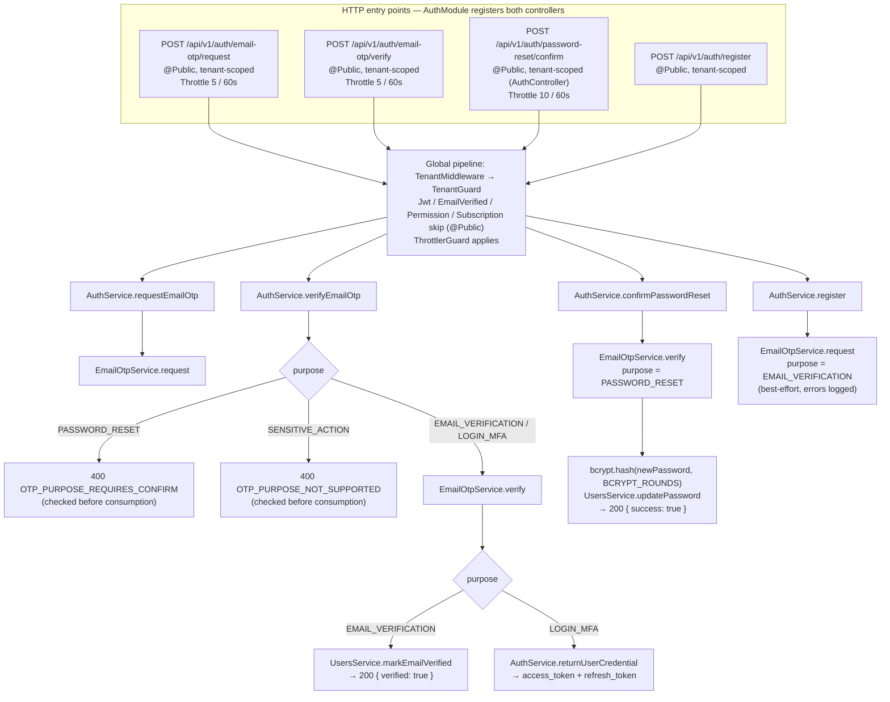
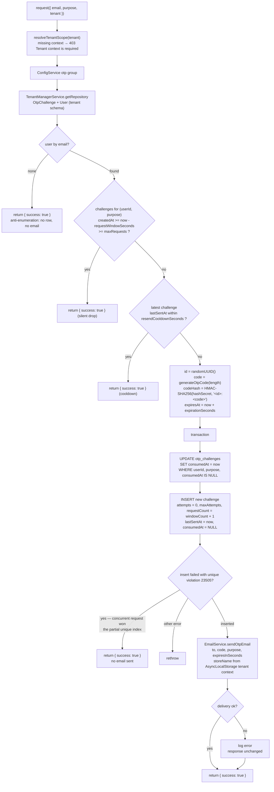
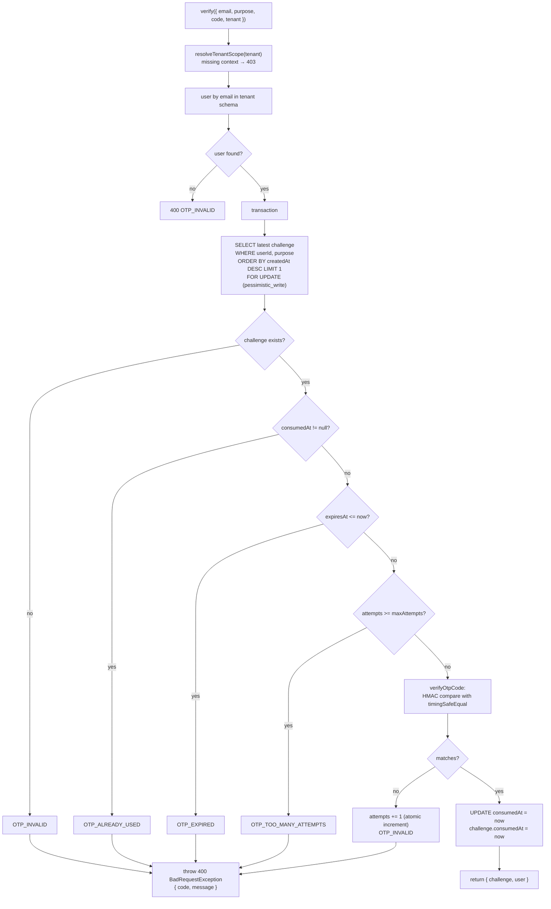
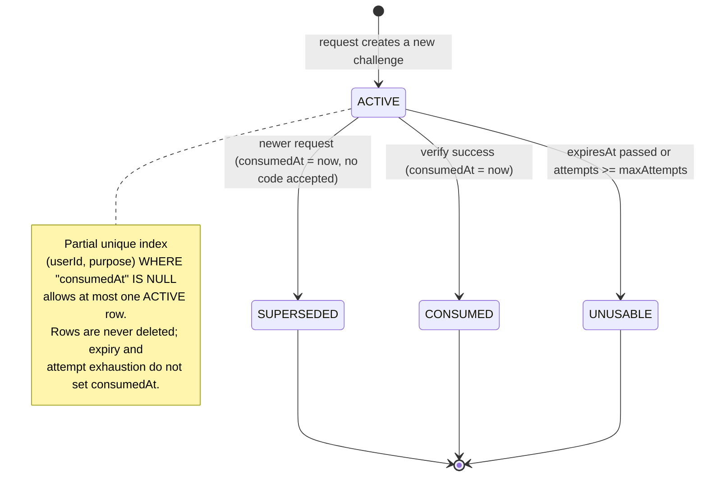

# email-otp — workflow

Ownership boundary:

- `EmailOtpService` (this module) owns **code generation, hashing, storage, throttling counters, and atomic consumption**. It knows nothing about what a purpose does.
- `AuthService` (`../auth`) owns **purpose routing and effects** (`markEmailVerified`, credential issuance, password update).
- `EmailService` (`../email`) owns **delivery** over the `EMAIL_TRANSPORT` seam.
- `OtpChallenge` is a **tenant** entity (`TENANT_ENTITIES`) — this flow is tenant-schema only. Platform (`SUPER_ADMIN`) OTP is out of scope.

All routes are `@Public()` but **not** `@Platform()`, so `TenantGuard` still runs and requires a resolvable ACTIVE tenant (`x-tenant-slug` / `x-tenant-id` / subdomain). The remaining global guards skip `@Public` routes; `ThrottlerGuard` still applies.

---

`PASSWORD_RESET` codes must be confirmed through `/auth/password-reset/confirm`; `SENSITIVE_ACTION` is reserved and rejected. Both rejections happen **before** `EmailOtpService.verify`, so the challenge is not consumed and attempts are not incremented.

---

Response is **always** `200 { success: true }`: unknown email, throttled window, cooldown, lost race, and email-delivery failure are indistinguishable to the caller.

The per-user limits are independent of the HTTP throttle:

- HTTP: `@Throttle 5 / 60s` per route.
- Window cap: `OTP_MAX_REQUESTS` per `OTP_REQUEST_WINDOW_SECONDS` per `(userId, purpose)`.
- Cooldown: `OTP_RESEND_COOLDOWN_SECONDS` since the latest challenge's `lastSentAt`.

---

The row lock serializes concurrent verifies: exactly one success consumes the challenge, and the rest see `OTP_ALREADY_USED`.

---

`OtpChallenge` (`otp_challenges`, tenant schema):

| Column | Notes |
| --- | --- |
| `id` | UUID generated in-app (part of the HMAC message) |
| `userId` / `user` | FK to tenant `user`, `ON DELETE CASCADE`, indexed |
| `email` | Snapshotted request email, indexed |
| `purpose` | `OtpPurpose` varchar |
| `codeHash` | hex HMAC-SHA256, never the plaintext code |
| `expiresAt`, `createdAt` | `timestamptz` |
| `attempts` / `maxAttempts` | incremented atomically on mismatch |
| `requestCount` | window count at creation (`windowCount + 1`) |
| `lastSentAt` | cooldown anchor |
| `consumedAt` | `NULL` = active; set by verify success or supersede |

Config (`otp` group, Joi-validated): `OTP_LENGTH` (default 6), `OTP_EXPIRATION_SECONDS` (600), `OTP_MAX_ATTEMPTS` (5), `OTP_RESEND_COOLDOWN_SECONDS` (60), `OTP_MAX_REQUESTS` (5), `OTP_REQUEST_WINDOW_SECONDS` (3600), required `OTP_HASH_SECRET`, `OTP_REQUIRE_EMAIL_VERIFIED` (false). Delivery uses `EMAIL_PROVIDER` = `smtp | log | memory`; `log` never writes the code.

## Errors

`otpError()` builds `400 BadRequestException` with `{ code, message }`:

| Code | When |
| --- | --- |
| `OTP_INVALID` | unknown email, no challenge, wrong code |
| `OTP_EXPIRED` | `expiresAt <= now` |
| `OTP_ALREADY_USED` | `consumedAt` set before verify |
| `OTP_TOO_MANY_ATTEMPTS` | `attempts >= maxAttempts` |
| `OTP_PURPOSE_REQUIRES_CONFIRM` | `PASSWORD_RESET` sent to `/auth/email-otp/verify` |
| `OTP_PURPOSE_NOT_SUPPORTED` | `SENSITIVE_ACTION` sent to `/auth/email-otp/verify` |

## Related behavior outside this module

- `AuthService.register` creates the CUSTOMER then calls `EmailOtpService.request(EMAIL_VERIFICATION)` best-effort; a failure is logged and registration still succeeds.
- `OTP_REQUIRE_EMAIL_VERIFIED=true` makes `POST /auth/login` reject unverified users with `401 { code: 'EMAIL_NOT_VERIFIED' }` before issuing credentials. Independently, `EmailVerifiedGuard` rejects every authenticated tenant route with `403 { code: 'EMAIL_NOT_VERIFIED' }` unless the route is `@Public`, `@Platform`, or `@AllowUnverifiedEmail()`.
- `LOGIN_MFA` can be requested and verified, but `POST /auth/login` does not issue an MFA challenge; a client must call the request route explicitly.
- Production schema changes for `otp_challenges` use the idempotent `test/migrate-otp-challenges.ts`; dev/staging rely on tenant `synchronize`.

## Validation

- `email-otp.service.spec.ts` — unknown email, supersede + send, cooldown, window cap, successful consumption, wrong code increments attempts, expired, already used, attempts cap, missing challenge, unknown email on verify.
- `otp-code.util.spec.ts` — code shape/zero-padding, per-challenge HMAC uniqueness, constant-time compare.
- `AuthService` spec covers purpose routing (`verifyEmailOtp` marks verified, `LOGIN_MFA` issues credentials, `PASSWORD_RESET` rejected before consumption).
