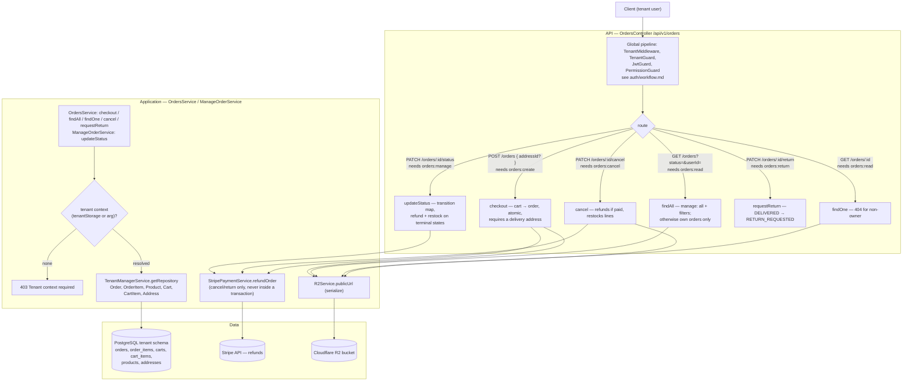
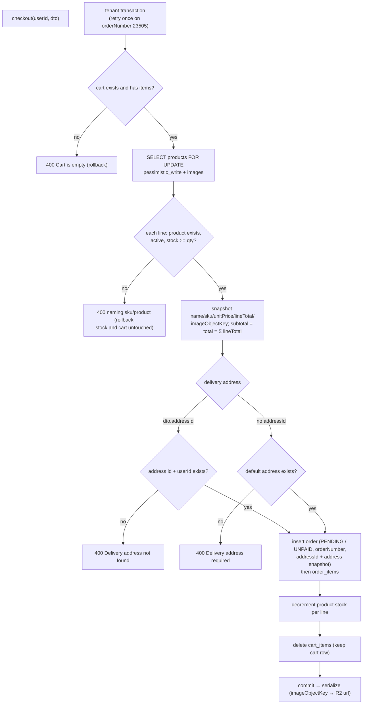
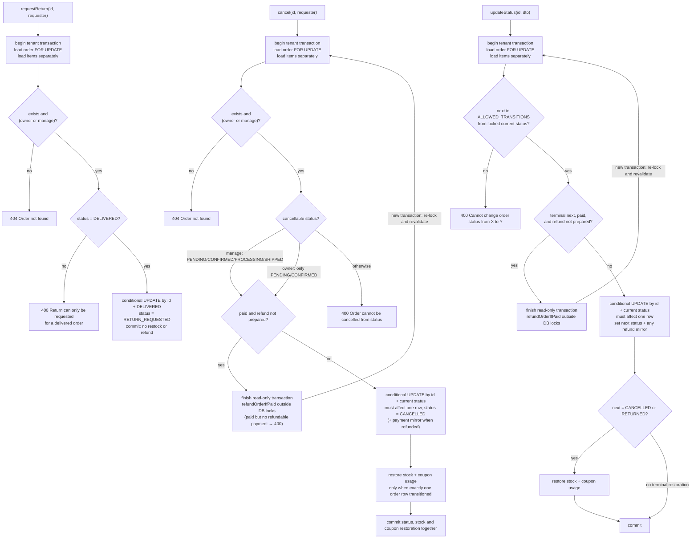

---

---

Order status transitions (`ManageOrderService.ALLOWED_TRANSITIONS`):

| From | Allowed next |
| --- | --- |
| `PENDING` | `CONFIRMED`, `CANCELLED` |
| `CONFIRMED` | `PROCESSING`, `CANCELLED` |
| `PROCESSING` | `SHIPPED`, `CANCELLED` |
| `SHIPPED` | `DELIVERED`, `CANCELLED` |
| `DELIVERED` | `RETURN_REQUESTED` |
| `RETURN_REQUESTED` | `RETURNED`, `DELIVERED` |
| `RETURNED`, `CANCELLED` | terminal |

Every status mutation loads the order with `pessimistic_write` inside its tenant transaction and validates the current locked status. Items use the query relation-loading strategy so the order lock does not target nullable joined rows. The conditional status update must affect exactly one row before stock or coupon usage is restored. The committed terminal status is the one-time restoration marker: concurrent or repeated requests cannot restore stock again, and failures roll back status, stock and coupon changes together.

For paid cancellation or return approval, a first locked, read-only transaction prepares the refund. Stripe runs outside DB transactions; the final transaction re-locks the order, revalidates eligibility, and commits the status, refund mirror, stock and coupon restoration together. An external refund cannot be rolled back if the status changes before that final recheck. Unpaid and non-refund transitions complete in one transaction.
