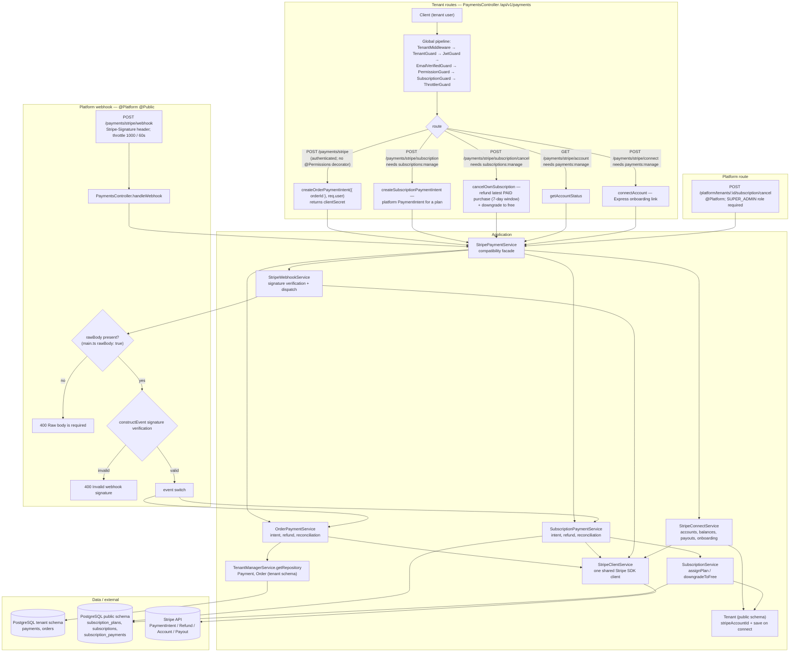
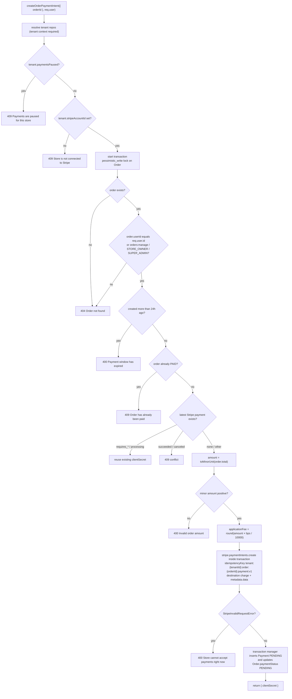
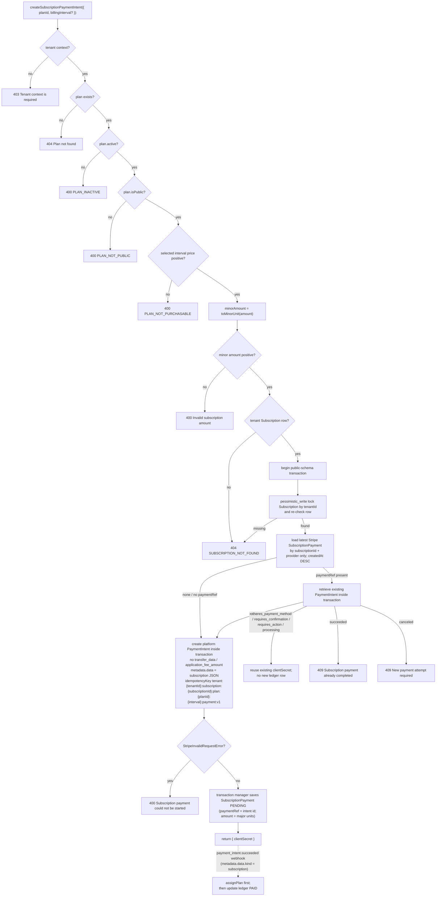
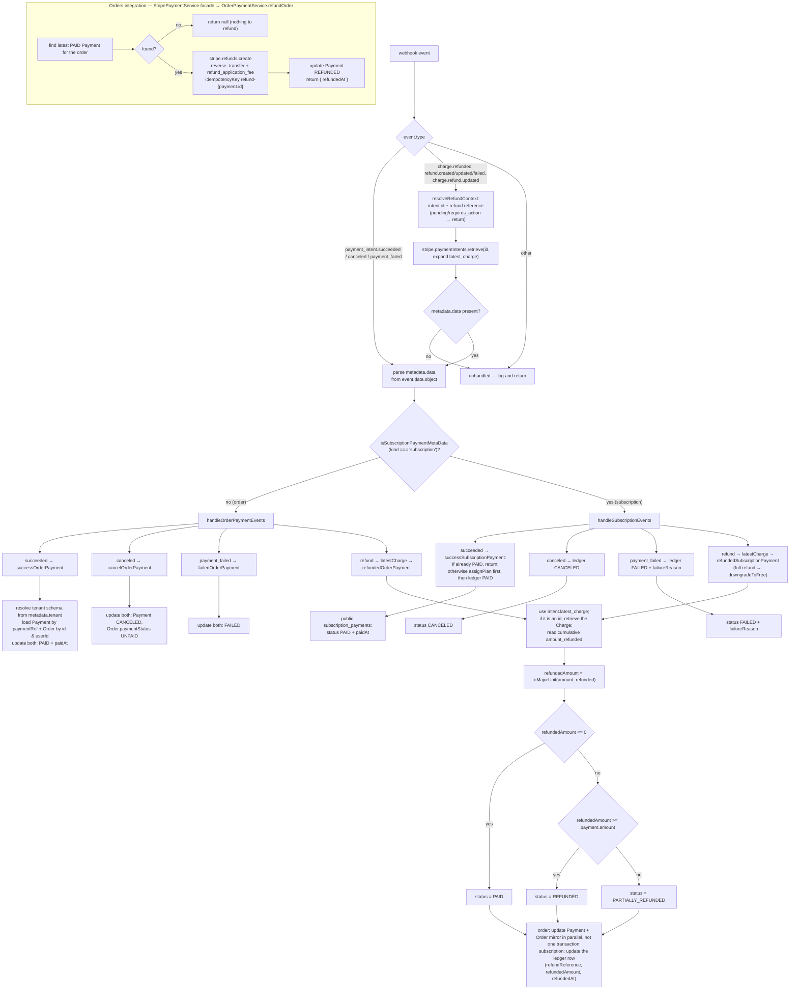

---

---

---

Notes:

- `POST /payments/stripe` has no `@Permissions` decorator, but still passes through the tenant, JWT, email-verification, subscription, and throttling guards. It passes `req.user` through the facade. `OrderPaymentService` permits the order owner or a user with `orders:manage`, `STORE_OWNER`, or `SUPER_ADMIN`; every other caller receives the same 404 as a missing order. Platform tokens still cannot access this tenant route. Stripe idempotency keys are scoped as `tenant:{tenantId}:order:{orderId}:payment:v1` to eliminate cross-tenant collisions on the platform account.
- `POST /payments/stripe/subscription` requires `subscriptions:manage` (seeded for STORE_OWNER; ADMIN has only `subscriptions:read` by default) and charges the **platform** Stripe account: no Connect account, `paymentsPaused` gate, `transfer_data`, or `application_fee_amount`. The tenant route has no `@Roles` restriction, so its effective authorization is permission-based. Inside a public-schema transaction it locks the tenant's `Subscription`, reuses the latest active Stripe intent, or creates a new intent with `tenant:{tenantId}:subscription:{subscriptionId}:plan:{planId}:{interval}:payment:v1` before saving a `PENDING` ledger row. The latest-attempt lookup is by subscription and provider, not by requested plan or interval.
- Neither payment ledger has a database uniqueness constraint on `paymentRef` or its logical attempt tuple. `SubscriptionPayment.idempotencyKey` is an unmapped, unwritten property. Duplicate prevention currently relies on the locked Order/Subscription row, latest-attempt lookup, and Stripe idempotency keys; only `Subscription.tenantId` is uniquely constrained.
- `webHook` is called through the compatibility facade, verifies the raw-body signature in `StripeWebhookService`, and classifies events on `metadata.data.kind` (`isSubscriptionPaymentMetaData`). Order metadata has no `kind`; subscription intents (`kind: 'subscription'`) route to `handleSubscriptionEvents`. Refund-family events carry no metadata, so the intent is fetched once with `latest_charge` and then routed. Order Payment/Order mirror writes run in parallel but not in one transaction. A **fully** refunded subscription payment falls back to the free plan; partial refunds and reversals keep the paid plan.
- `successSubscriptionPayment` returns immediately only when the ledger is already `PAID`. Otherwise it calls `SubscriptionService.assignPlan` before updating the ledger. Plan assignment, storage-capacity synchronization, and the ledger update do not share a transaction; a failure after assignment but before `PAID` can cause a retry to assign the plan again. A missing `SubscriptionPayment` row or `PLAN_INACTIVE` still returns non-2xx so Stripe retries.
- `POST /platform/tenants/:id/subscription/cancel` (`@Platform @Roles([SUPER_ADMIN])`) finds the latest `PAID` ledger row and refunds it only when `paymentRef` exists; no PAID row or a missing reference does not prevent the free-plan downgrade. `POST /payments/stripe/subscription/cancel` requires `subscriptions:manage` and instead returns `SUBSCRIPTION_NOT_REFUNDABLE` unless a previous `REFUNDED` row proves an idempotent repeat. It enforces `SUBSCRIPTION_REFUND_WINDOW_DAYS` (7) from `paidAt` (fallback `createdAt`); `GET /subscription` exposes an advisory `refundEligible`/`refundDeadline` snapshot, while the cancel route re-checks authoritatively.
- Both subscription cancellation flows execute Stripe refund → ledger update → downgrade without one database transaction. `refund-subscription-{paymentId}` deduplicates repeated route/service refund creation; refund webhooks do not use that key and only reconcile Stripe's cumulative refunded amount.
- `refundOrder` performs the Stripe refund and marks the Payment `REFUNDED` before `OrdersService.cancel` or `ManageOrderService.updateStatus` starts its Order/restock/coupon transaction. No transaction spans these stages; a later order transaction failure can leave the payment ledger refunded while the Order remains unchanged. PaymentIntent creation still calls Stripe while its pessimistic Order lock is open.
- `OrderPaymentService.cancelOrderPayment` / `failedOrderPayment` write `canceledAt` / `failedAt`; those columns are not declared on the `Payment` (or `Order`) entity today, so treat them as intended state fields rather than persisted ones.
