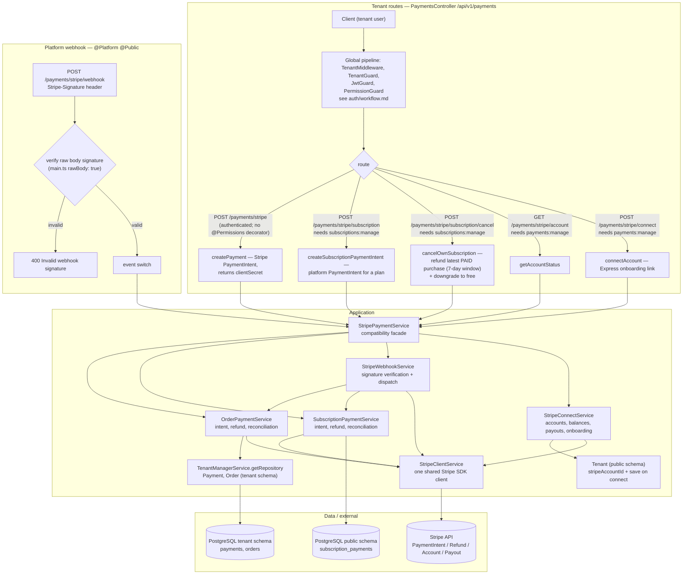
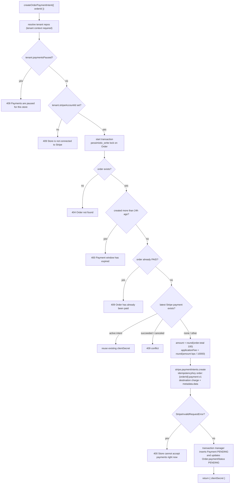
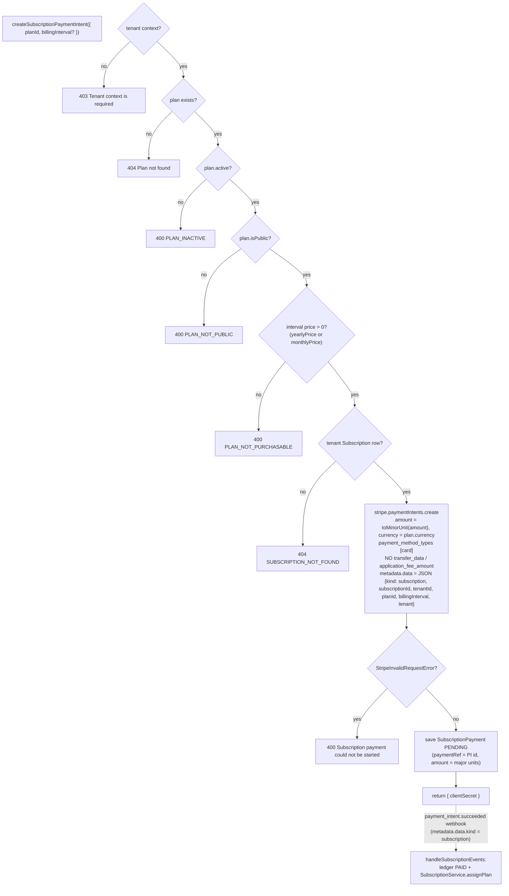
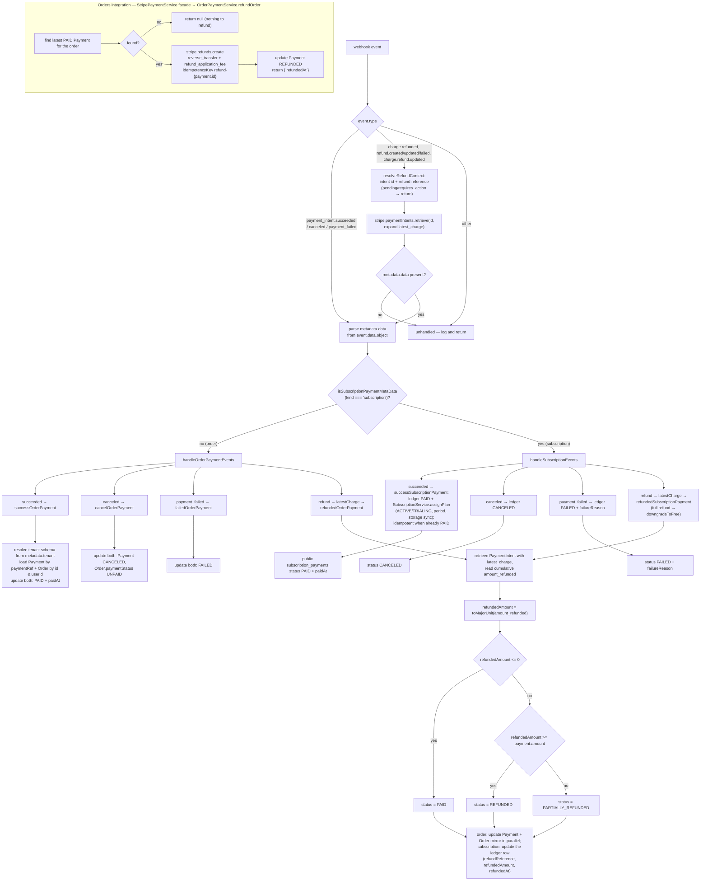

---

---

---

Notes:

- `POST /payments/stripe` has no `@Permissions` decorator, so any authenticated tenant user passes the guard; the order lookup is by `orderId` alone, not by `order.userId`.
- `POST /payments/stripe/subscription` requires `subscriptions:manage` (STORE_OWNER only; ADMIN has `subscriptions:read` only) and charges the **platform** Stripe account: no Connect account, no `paymentsPaused` gate, no `transfer_data`/`application_fee_amount`. It persists a `PENDING` `SubscriptionPayment`; the plan is assigned only when the `payment_intent.succeeded` webhook reconciles the intent (`kind === 'subscription'` → `handleSubscriptionEvents` → `successSubscriptionPayment` → `assignPlan` + ledger `PAID`).
- `webHook` classifies events on `metadata.data.kind` (`isSubscriptionPaymentMetaData`): order metadata has no `kind`, so the order path is byte-identical; subscription intents (`kind: 'subscription'`) route to `handleSubscriptionEvents`. Refund-family events carry no metadata, so the intent is fetched once (with `latest_charge`) and then routed. A **fully** refunded subscription payment (`status === REFUNDED`) falls back to the free plan via `SubscriptionService.downgradeToFree` (period reset + storage capacity re-synced); partial refunds and reversals keep the paid plan, and the fallback is idempotent across webhook retries.
- `successSubscriptionPayment` early-returns when the ledger row is already `PAID`, so Stripe webhook retries/redeliveries do not reset the subscription period. A missing `SubscriptionPayment` row (or a `PLAN_INACTIVE` on assign) still throws → non-2xx → Stripe retries.
- `POST /platform/tenants/:id/subscription/cancel` (`@Platform @Roles([SUPER_ADMIN])`, in `PaymentsModule`) = `StripePaymentService.cancelSubscriptionWithRefund`: it refunds the latest `PAID` `SubscriptionPayment` on the **platform** account (no `reverse_transfer`/`refund_application_fee`; idempotency key `refund-subscription-{paymentId}`), marks the ledger `REFUNDED`, then calls `downgradeToFree`. Idempotent — a repeat finds no `PAID` row and only re-runs the (no-op) free fallback. This mirrors, and does not conflict with, the refund **webhook** reconciliation above.
- `POST /payments/stripe/subscription/cancel` (`subscriptions:manage`, tenant-scoped, in `PaymentsModule`) = `StripePaymentService.cancelOwnSubscription`: the self-serve counterpart but bounded by `SUBSCRIPTION_REFUND_WINDOW_DAYS` (7) from the latest `PAID` row's `paidAt` (fallback `createdAt`). Only `PAID` rows are considered (an in-flight `PENDING` upgrade never blocks refunding the earlier paid purchase); it reuses the same refund helper so the idempotency key dedupes with a refund webhook. Errors: `404 SUBSCRIPTION_NOT_FOUND`, `409 SUBSCRIPTION_NOT_REFUNDABLE` (no paid purchase), `409 REFUND_WINDOW_EXPIRED`; a repeat after `REFUNDED` is a `200` no-op. `GET /subscription` reports `refundEligible`/`refundDeadline` from the same window (read-time, advisory — this route re-checks).
- `refundOrder` is called by `OrdersService.cancel` and `ManageOrderService.updateStatus` **before** their DB transactions. `createOrderPaymentIntent` retains its current reliability behavior and calls Stripe while its pessimistic order-lock transaction is open.
- `OrderPaymentService.cancelOrderPayment` / `failedOrderPayment` write `canceledAt` / `failedAt`; those columns are not declared on the `Payment` (or `Order`) entity today, so treat them as intended state fields rather than persisted ones.
