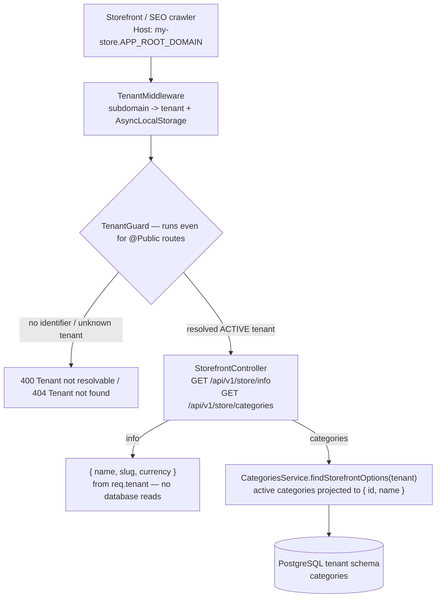
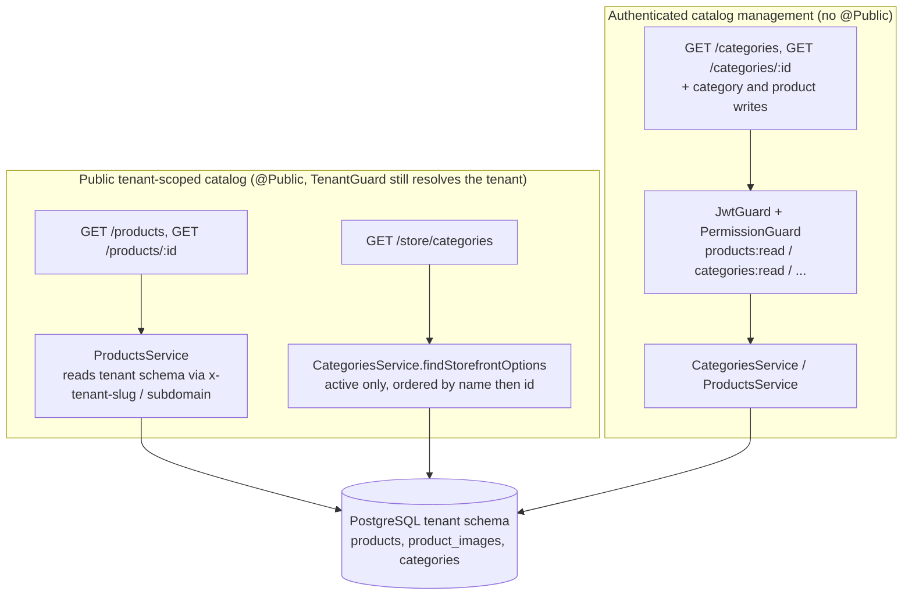

`GET /store/categories` is additive and intentionally uncached (no `@CacheResponse`), so the response
interceptor emits `Cache-Control: private, no-store` and `X-Cache: BYPASS`. It exposes only active
category IDs and names; it does not make the protected `/categories` management routes public.

The storefront application (`apps/tenant_store`) renders `/products` in a Server Component. It
resolves the tenant from the trusted `x-tenant-slug` header, then loads `/store/categories` and the
filtered `/products` envelope concurrently through a request-local anonymous Axios instance that
sends only that tenant header — no session token or cookies. Filter state lives in the URL. Browser
code still calls the backend directly for authenticated cart/order/payment flows.
