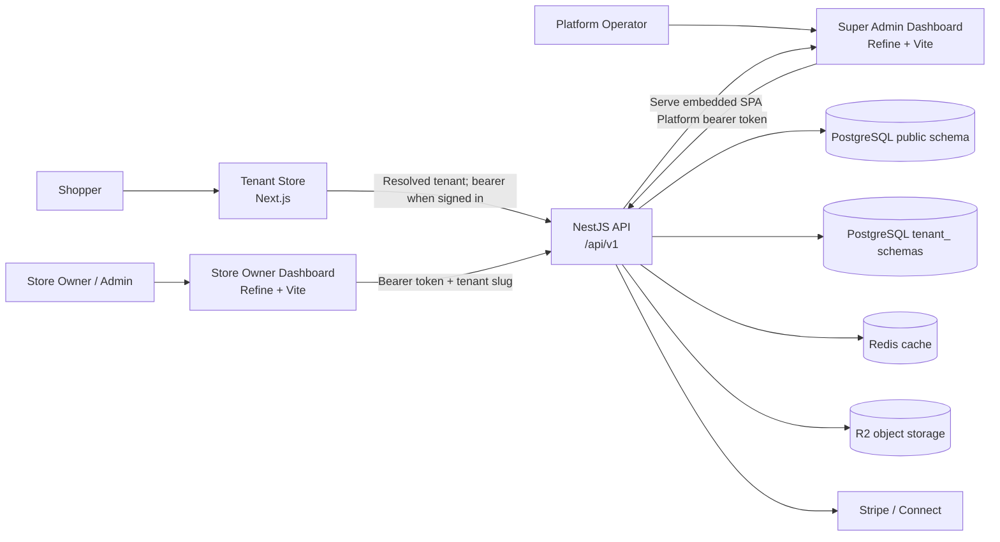

# System Patterns

## Repository shape

The workspace discovers `apps/*` and `packages/*`, while current package manifests identify four applications: `saas_store_api`, `tenant_dash`, `super_admin_dash`, and `tenant_store` (`pnpm-workspace.yaml:1-3`; `apps/api/package.json:1-8`; `apps/store_owner_dashboard/package.json:1-5`; `apps/super_admin_dashboard/package.json:1-5`; `apps/tenant_store/package.json:1-5`). No shared `packages/*` package was found during this refresh, so shared-package ownership is **unknown**.

## Architecture diagram

The client/API edges are evidenced by the three client implementations and API static hosting; the infrastructure edges are registered through the API core, tenant manager, and payment modules (`apps/tenant_store/src/api/apiClient.ts:8-24`; `apps/store_owner_dashboard/src/api/client.ts:55-75`; `apps/super_admin_dashboard/src/api/client.ts:51-62`; `apps/api/src/app.module.ts:31-55`; `apps/api/src/core.module.ts:44-77`; `apps/api/src/modules/tenants/services/tenant-manager.service.ts:71-80`; `apps/api/src/modules/payments/payments.module.ts:1-40`).

## Key decisions and rationale

- **Separate public and tenant persistence.** The declared goal is tenant data isolation, and source enforces it with disjoint entity lists and schema-bound data sources (`project-description.md:3-5`; `apps/api/src/core.module.ts:27-42`; `apps/api/src/modules/tenants/utils/tenant-entities.ts:18-34`).
- **Resolve tenancy at ingress.** Storefront proxying replaces untrusted tenant headers and the API resolves a deterministic id/slug/subdomain precedence before repository access, reducing cross-tenant ambiguity (`apps/tenant_store/src/proxy.ts:33-55`; `apps/api/src/modules/tenants/services/tenant-resolution.service.ts:30-58`).
- **Keep enforcement server-side.** Frontends may offer UX checks, but ordered global guards and service checks make the API the security/entitlement boundary (`apps/api/src/app.module.ts:75-100`; `apps/store_owner_dashboard/AGENTS.md:85-91`; `apps/api/AGENTS.md:413-438`).
- **Embed the platform SPA in production.** The Super Admin build targets API static output and uses `/platform/` as its base, giving the API one delivery point for platform UI and deep links (`apps/super_admin_dashboard/vite.config.ts:58-80`; `apps/api/src/app.module.ts:31-55`).
- **Make external-event handling durable.** Current webhook work persists Stripe events before processing and combines database claims, resource locks, idempotency, and retries; this decision is still uncommitted at the snapshot (`apps/api/src/modules/payments/webhooks/stripe-webhook.service.ts:64-124`; `apps/api/src/modules/payments/webhooks/stripe-webhook.service.ts:197-385`).

## API request and tenancy pattern

1. Nest bootstraps with raw-body support, CORS, validation that strips/rejects unknown fields, response caching, serialization, and a global API prefix (`apps/api/src/main.ts:12-64`).
2. Tenant middleware only resolves API paths, attaches the tenant, and establishes async tenant context (`apps/api/src/modules/auth/tenant.middleware.ts:11-27`).
3. Resolution precedence is tenant id header, tenant slug header, then configured-root subdomain (`apps/api/src/modules/tenants/services/tenant-resolution.service.ts:30-58`).
4. Global guards are ordered tenant, JWT, email verification, permission, subscription, then throttling (`apps/api/src/app.module.ts:75-100`).
5. Public data uses the root TypeORM data source; tenant data uses a schema-bound data source built from `TENANT_ENTITIES` (`apps/api/src/core.module.ts:27-42`; `apps/api/src/modules/tenants/services/tenant-manager.service.ts:71-81`).

See [API Multi-tenancy](../apps/api/AGENTS.md#multi-tenancy) and [API Auth, JWT, RBAC](../apps/api/AGENTS.md#auth-jwt-rbac) for durable editing rules.

## Frontend boundaries

- **Super Admin:** Refine/Vite SPA, platform-only API client, route-level lazy loading, and a basename derived from the build base (`apps/super_admin_dashboard/src/App.tsx:28-97`; `apps/super_admin_dashboard/src/App.tsx:99-178`; `apps/super_admin_dashboard/src/api/client.ts:51-62`).
- **Store Owner:** Refine/Vite SPA with tenant-param synchronization, tenant header injection, protected application routes, and public recovery routes (`apps/store_owner_dashboard/src/App.tsx:76-109`; `apps/store_owner_dashboard/src/App.tsx:111-177`; `apps/store_owner_dashboard/src/api/client.ts:55-75`).
- **Tenant Store:** Next.js request proxy classifies hosts, overwrites untrusted tenant headers, separates apex/platform from tenant paths, and enforces protected-route session handling (`apps/tenant_store/src/proxy.ts:33-55`; `apps/tenant_store/src/proxy.ts:132-250`). Its isomorphic Axios client derives session/tenant context differently on server and browser (`apps/tenant_store/src/api/apiClient.ts:133-154`).

See [Store Owner Tenant Resolution](../apps/store_owner_dashboard/AGENTS.md#dev-url-and-tenant-header), [Super Admin Platform Scope](../apps/super_admin_dashboard/AGENTS.md#platform-scope), and [Tenant Store Resolution](../apps/tenant_store/AGENTS.md#tenant-resolution).

## Cross-cutting contracts

- API routes live below `/api/v1`; the embedded platform UI lives outside that prefix at `/platform` (`apps/api/src/main.ts:56-64`; `apps/api/src/app.module.ts:31-55`).
- Tenant clients send `x-tenant-slug`; the platform client deliberately does not (`apps/store_owner_dashboard/src/api/client.ts:61-75`; `apps/super_admin_dashboard/src/api/client.ts:51-62`).
- Authenticated clients use bearer access tokens and single-flight refresh; definitive refresh rejection clears the local session (`apps/store_owner_dashboard/src/api/client.ts:86-120`; `apps/super_admin_dashboard/src/api/client.ts:73-107`; `apps/tenant_store/src/api/apiClient.ts:29-55`; `apps/tenant_store/src/api/apiClient.ts:112-129`).
- The Store Owner data provider expects list responses shaped as `{ data, total }`, with client-side fallback for arrays (`apps/store_owner_dashboard/AGENTS.md:174-182`).
- API domain errors commonly use `{ code, message }`; the frontend API error adapters preserve a machine-readable code where supported (`apps/api/AGENTS.md:435-438`; `apps/store_owner_dashboard/AGENTS.md:171-172`).

## Consistency and concurrency patterns

- Tenant data-source creation is single-flight; active sources are LRU-refreshed and capped at 100 (`apps/api/src/modules/tenants/services/tenant-manager.service.ts:9-45`; `apps/api/src/modules/tenants/services/tenant-manager.service.ts:84-96`).
- Order mutations load the current order with a database write lock before transition (`apps/api/src/modules/orders/orders.helpers.ts:113-119`).
- Current working-tree Stripe webhook processing first persists a unique event inbox row, claims it transactionally, serializes each Stripe resource with a PostgreSQL advisory lock, and records retry metadata on failure (`apps/api/src/modules/payments/entities/stripe-webhook-event.entity.ts:13-77`; `apps/api/src/modules/payments/webhooks/stripe-webhook.service.ts:197-283`; `apps/api/src/modules/payments/webhooks/stripe-webhook.service.ts:306-385`). This pattern is present but uncommitted at the refresh snapshot; see `activeContext.md`.
- Payment state handlers lock payment/order rows and preserve terminal states against late events (`apps/api/src/modules/payments/services/order-payment.service.ts:254-319`; `apps/api/src/modules/payments/services/order-payment.service.ts:330-380`; `apps/api/src/modules/payments/services/order-payment.service.ts:459-495`).

## Build integration

The embedded Super Admin build uses `/platform/` and writes into `apps/api/static`; the API registers both root and deep-link static handlers (`apps/super_admin_dashboard/vite.config.ts:58-80`; `apps/api/src/app.module.ts:31-55`). Follow [Embedded Platform Dashboard](../apps/api/AGENTS.md#embedded-platform-dashboard) and [Dashboard Build Output](../apps/super_admin_dashboard/AGENTS.md#build-output-and-base-path).

## Known quirks

- Store Owner host parsing intentionally differs between API-header and JWT guard helpers in subdomain mode; local development must use the documented tenant-host pattern (`apps/store_owner_dashboard/AGENTS.md:19-33`; `apps/store_owner_dashboard/AGENTS.md:48-50`).
- API lint runs with `--fix`, so it is not a read-only verification command (`apps/api/package.json:17-17`; `apps/api/AGENTS.md:546-546`).
- General schema migration ownership is not established; synchronization and feature-specific idempotent scripts coexist (`apps/api/AGENTS.md:542-543`; `apps/api/package.json:24-30`).
- The platform identity shape does not match the avatar/info component expectation, so those fields can render blank (`apps/super_admin_dashboard/AGENTS.md:139-143`).

## Contract gap

App-level instruction files claim a root `AGENTS.md` owns cross-app contracts, but that file is absent (`apps/api/AGENTS.md:6-7`; `apps/tenant_store/AGENTS.md:6-6`). Until restored, cross-app contract authority is **unknown**; do not infer missing rules from this bank.
